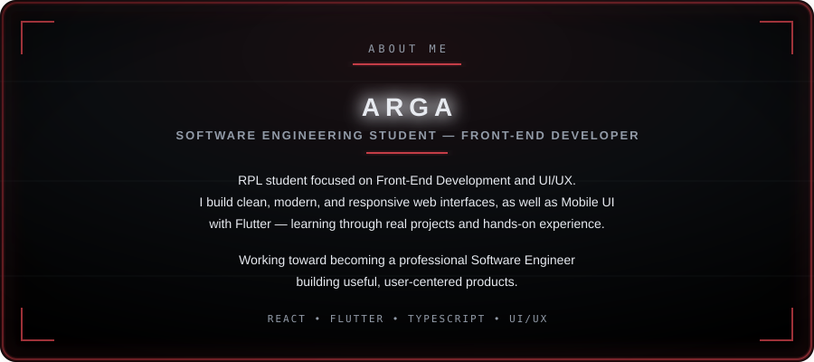
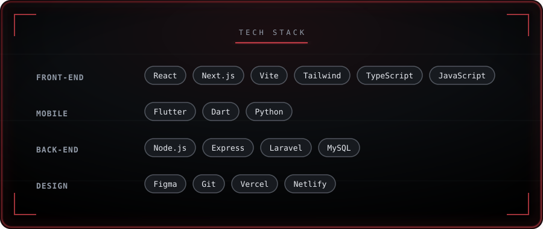
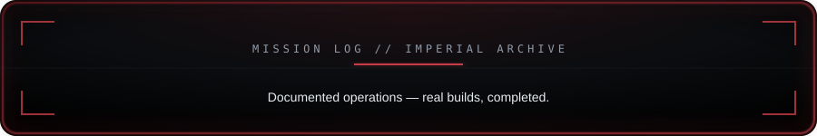
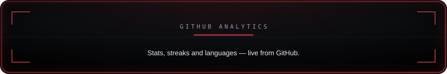
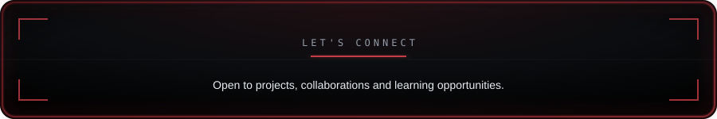
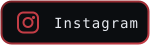
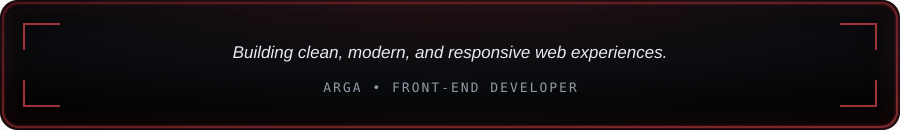

**[About](#about) · [Tech Stack](#arsenal) · [Mission Log](#mission-log) · [Analytics](#analytics) · [Connect](#connect)**

---

---

---

<table>
<tr>
<td width="50%" valign="top">

### ◈ REBITES — Surplus Food Platform

Surplus-food platform yang menghubungkan pengguna dengan UMKM di Kota Depok.

**Fokus:** katalog UMKM • listing surplus • transaksi hemat-buang

**Tech:** `TypeScript` `Next.js` `Tailwind`

 

<a href="https://github.com/kayy-eci/Rebitesss-oscar3.0">View Repository →</a>

 

</td>
<td width="50%" valign="top">

### ◈ CICIPYUK — Culinary Blog App

Aplikasi blog kuliner untuk jelajah dan ulas makanan.

**Fokus:** auth • CRUD post • feed kuliner

**Tech:** `Flutter` `Express` `SQL`

 

<a href="https://github.com/argottzz/CicipYuk-blogApp">View Repository →</a>

 

</td>
</tr>
</table>

| CURRENTLY LEARNING | ACTIVE PROJECTS | NEXT OBJECTIVE |
|---|---|---|
| Improving my skills in TypeScript, Flutter, and full-stack development. | Exploring new features, refining UI/UX, and improving code quality in my existing projects. | Build more polished applications and expand my technical knowledge. |

---

 

  

---

 

**Consistency is the game. Every commit is progress.**

  

<picture>
  <source media="(prefers-color-scheme: dark)" srcset="https://raw.githubusercontent.com/argottzz/argottzz/output/pacman-contribution-graph-dark.svg">
  <source media="(prefers-color-scheme: light)" srcset="https://raw.githubusercontent.com/argottzz/argottzz/output/pacman-contribution-graph.svg">
  
</picture>

  

---

 

I'm always open to interesting projects, collaborations, internships, and learning opportunities.

 

 

 

